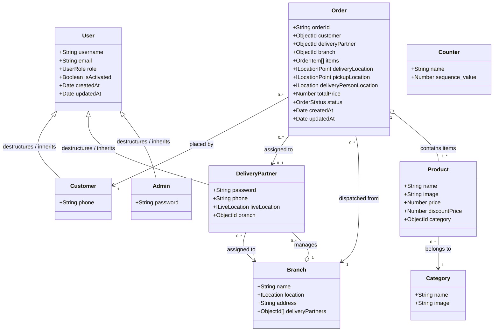

# Database Schema & Class Diagram

This document contains the visual entity-relationship and class diagram for the Grocery App backend.

---

## Class & Relationship Diagram

---

## Relationship Overview

1. **User Inheritance**:
   - `Customer`, `DeliveryPartner`, and `Admin` destructure the base `User` schema (`username`, `email`, `role`, `isActivated`).

2. **Branch & Delivery Partner**:
   - Each `DeliveryPartner` points to a `Branch`.
   - Each `Branch` maintains a list of assigned `DeliveryPartner` IDs.

3. **Catalog (Category & Product)**:
   - Each `Product` holds an `ObjectId` reference to its `Category`.

4. **Order Lifecycle**:
   - An `Order` references the `Customer` who ordered, the `Branch` it will be fulfilled from, and the `DeliveryPartner` assigned to deliver it.
   - The `Order` embeds an array of item references (`Product`) along with each item's quantity (`count`).
